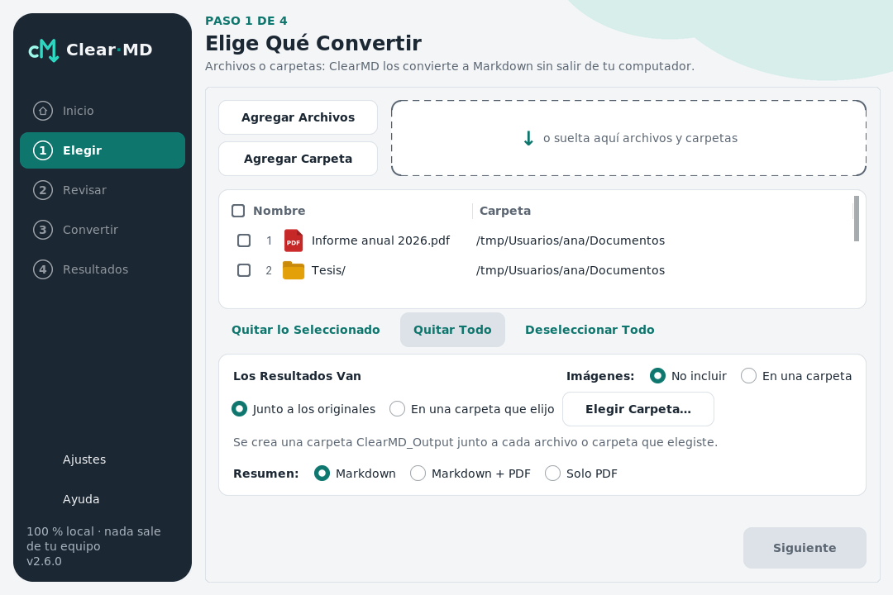
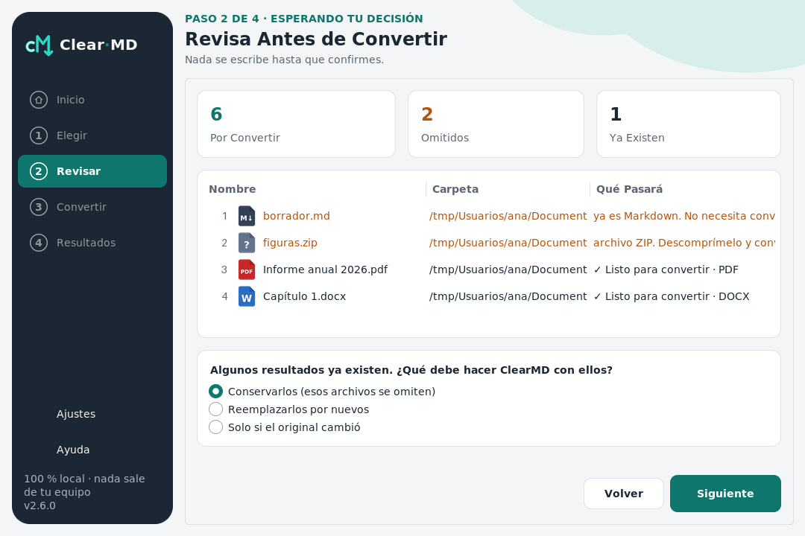
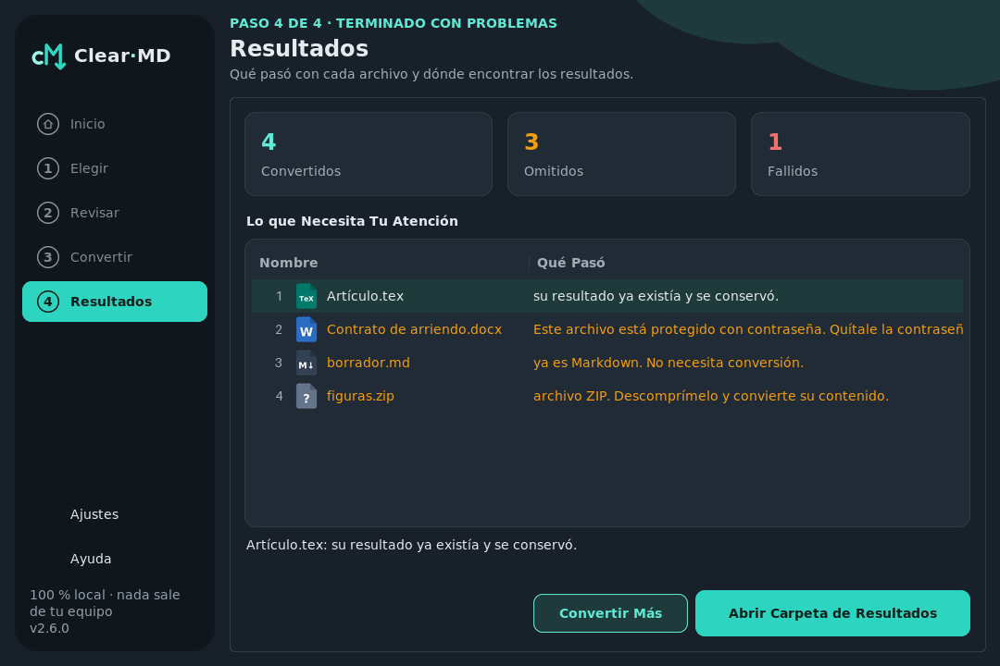

<div align="center">


# Clear·MD

**Convierte tus documentos a Markdown — 100% local: ClearMD nunca usa internet.**

_PDF, Word, OpenDocument, PowerPoint, Excel, HTML, CSV, EPUB, notebooks y LaTeX (con sus ecuaciones) → Markdown limpio, una
carpeta entera de una vez,
pensado primero para quienes nunca abren una terminal._


### [⬇️ Descargar ClearMD para Windows](https://github.com/ClearNote97/ClearMD/releases/latest)

<sub>Abre la versión más reciente y toma <code>ClearMD-Setup-&lt;versión&gt;.exe</code>: se instala y desinstala como cualquier programa de Windows. Linux: el <code>.tar.gz</code> de la misma versión.</sub>

[Read in English](./README.md)

</div>

> 👋 **¿Quieres conocer mis otros proyectos?** → **[github.com/ClearNote97](https://github.com/ClearNote97)**

---

## 🧩 El problema

> **El contenido útil está atrapado en formatos pesados, y las herramientas para liberarlo no son para todos.**

Notas para Obsidian, documentación para GitHub, contexto para un LLM: todo eso pide Markdown, mientras el
contenido vive en PDFs, Word y hojas de cálculo. Las respuestas que existen son librerías de línea de comandos,
servicios web que te obligan a **subir tus documentos**, o conversores de un solo formato. Ninguna está hecha para
alguien que nunca ha abierto una terminal — y los documentos privados (contratos, historias clínicas, tesis sin
publicar) nunca deberían tener que salir de la máquina.

---

## 🧠 Cómo lo resolví

El valor está en el método — un producto pequeño construido como uno serio:

1. **Primero las decisiones, por escrito.** Cada decisión no trivial es un ADR en
   [`docs/decisions/`](./docs/decisions/) (23 hasta hoy), con las alternativas descartadas y su costo: por qué
   PySide6 y no PyQt6, por qué sin pandoc, por qué sin base de datos, por qué un proceso aparte.
2. **La spec antes que el código.** Con **Spec-Driven Development**, [`spec/`](./spec/) dice lo que *debe* ser
   verdad: la feature 001 tiene 44 criterios de aceptación y la 002 tiene 22, y un test falla si algún criterio de
   cualquier feature queda sin su test.
3. **Un núcleo que no sabe nada de afuera.** Arquitectura hexagonal organizada con las carpetas `backend/` y
   `frontend/` de mi plantilla: los casos de uso solo importan la librería estándar; markitdown y magika viven
   detrás de puertos y corren **solo en un proceso aparte**.
4. **Archivos no confiables, tratados como tales.** Las bombas ZIP se detectan desde el índice antes de
   descomprimir nada; nunca se siguen enlaces; cada archivo corre con límite de tiempo y de memoria (con tope duro
   del sistema operativo); un enlace plantado en la carpeta de salida no puede desviar una escritura; Ctrl+C
   detiene al instante. Una tesis en LaTeX se sigue solo dentro de su carpeta y sus macros se expanden con un
   presupuesto (una bomba de macros se detiene), y el Markdown nunca trae HTML, una imagen remota ni un enlace
   que el documento no escribió como LaTeX — lo comprueban en la suite un parser CommonMark y un fuzz. Un `.odt`
   se lee con un lector XML propio de ClearMD (sin `DOCTYPE`, con límites de tamaño y profundidad), con la misma
   garantía y un presupuesto para que ningún archivo pequeño se multiplique en un Markdown enorme. Una página web
   en **modo artículo** (`--html article`) conserva solo su artículo —sin menús, avisos de cookies ni pies de
   página—, escrito por ClearMD con la misma garantía: sus imágenes nunca se descargan, y una página sin
   artículo también la escribe ClearMD completa.
5. **Medido, no adivinado.** Los benchmarks ([001](./docs/benchmarks/001-conversion-limits.md),
   [002](./docs/benchmarks/002-tex-converter.md), [003](./docs/benchmarks/003-odt-converter.md),
   [004](./docs/benchmarks/004-html-article-mode.md)) fijaron los límites y la velocidad de cada formato: el xlsx es el cuello de botella por
   memoria, un PDF se lee a ~100 páginas/s con PDFium (ADR-0030), una tesis de 300 páginas en LaTeX tarda ~3 s y un informe `.odt` de 300 páginas, menos de un
   segundo. Los
   archivos se convierten del más liviano al más pesado, y el tiempo restante se estima con la velocidad real del
   lote.
6. **Revisado por ojos independientes.** Una revisión de código, una auditoría de seguridad y una verificación
   adversarial de los arreglos — que encontró huecos reales en la primera ronda, cerrados antes de publicar. Para los
   conversores de LaTeX y de OpenDocument hicieron falta tres rondas en cada uno, para el modo artículo dos:
   todas están en el historial, con el test que reproduce cada hallazgo.

> 🤖 Trabajé esto con un agente de IA (**Claude Code**): yo dirijo — defino el problema, decido el diseño y
> reviso cada paso; el agente ejecuta y deja todo trazado.

---

## 👀 Un vistazo

**La app de escritorio** — un lote real, desde elegir una carpeta hasta los resultados (sin internet):


| Elegir | Revisar | Resultados |
|---|---|---|
|  |  |  |

Claro y oscuro, español e inglés: todas las pantallas están en [`docs/screenshots/007/`](./docs/screenshots/007/).

**La línea de comandos** — una carpeta mixta, con un PDF protegido con contraseña, un documento sin extensión, dos archivos que quedarían
con el mismo nombre y una bomba ZIP disfrazada de Word:

```text
$ clearmd Tesis/ --lang es
– Omitido: factura.docx — crece 338 veces al descomprimirse; límite 100 (posible bomba ZIP). Si es
  confiable, guarda una copia nueva desde su programa.
[1/5] escaneado
[2/5] Informe.docx · faltan menos de un minuto
[3/5] informe.pdf · faltan menos de un minuto
[4/5] datos.xlsx · faltan menos de un minuto
[5/5] contrato.pdf · faltan menos de un minuto
✗ Falló: contrato.pdf — Este archivo está protegido con contraseña. Quítale la contraseña e inténtalo de nuevo.
4 convertidos · 1 omitidos · 1 con error
Resultados: ClearMD_Output
```

Y el `Resumen_ClearMD.md` que deja junto a los resultados:

| Origen | Resultado | Formato | Tiempo |
|---|---|---|---|
| `Tesis/escaneado` | `OutputMD/Tesis/escaneado.md` | DOCX, detectado por su contenido | <1 s |
| `Tesis/Informe.docx` | `OutputMD/Tesis/Informe (docx).md` | DOCX | <1 s |
| `Tesis/informe.pdf` | `OutputMD/Tesis/informe (pdf).md` | PDF | <1 s |
| `Tesis/capitulos/datos.xlsx` | `OutputMD/Tesis/capitulos/datos.md` | XLSX | <1 s |

_Además, los archivos con error y omitidos con su razón en palabras sencillas, y el historial de lotes
anteriores._

---

## 🚧 Estado

| Feature | | |
|---|---|---|
| **001** Conversión por lotes — backend + CLI | ✅ lista | 512 tests · revisada |
| **002** Conversor de `.tex` (con ecuaciones, sin pandoc) | ✅ lista | 807 tests en total · revisada |
| **003** Conversor de `.odt` (solo librería estándar) | ✅ lista | 1085 tests en total · revisada |
| **004** Modo artículo para HTML | ✅ lista | 1287 tests en total · revisada |
| **005** Primera app de escritorio (ttkbootstrap) | ✅ lista | 1622 tests en total · revisada |
| **006** CI + ejecutables para Windows y Linux | ✅ lista | CI en Linux y Windows · ejecutables verificados con un lote real |
| **007** Navegación libre, casillas, una ventana más fluida | ✅ lista | v0.2.0 · revisada |
| **008** PDF de calidad: PDFium lee, ClearMD limpia | ✅ lista | v0.3.0 · revisada |
| **009** Un resumen en lenguaje humano, y su PDF | ✅ lista | v0.4.0 · revisada · [muestras](./docs/screenshots/009/) |
| **010** Un ejecutable liviano: de unos 90 MB a 40 | ✅ lista | v0.5.0 · revisada |
| **011** Pulido de ventana II: secciones del riel, el área demarcada, cada mensajito | ✅ lista | v0.6.0 · revisada |
| **012** Las imágenes de cada documento en una carpeta junto a su Markdown (opcional) | ✅ lista | v0.7.0 · revisada |
| **013** Tablas de PDF (a la manera de Camelot), ecuaciones e índices | ✅ lista | v0.8.0 · revisada |
| **014** Subíndices y superíndices en PDF, un solo margen, tarjetas atenuadas | ✅ lista | v0.9.0 · revisada |
| **015** Las ecuaciones de un PDF como LaTeX | ✅ lista | v0.10.0 |
| **016** La misma app en PySide6 (Qt) | ✅ lista | v0.11.0 |
| **017** Instalador y desinstalador para Windows | ✅ lista | v0.12.0 |
| **018** La app en flet — ClearMD 1.0 | ✅ lista | v1.0.0 · [capturas](./docs/screenshots/018/) |
| **019** El instalador con el aspecto de ClearMD (claro y oscuro) | ✅ lista | v0.13.2 · [capturas](./docs/screenshots/019/) |
| **020** El resumen solo en PDF | ✅ lista | v1.1.0 |
| **021** La lista vacía de flet como dos tarjetas grandes; títulos en Title Case | ✅ lista | v1.2.0 · [capturas](./docs/screenshots/018/) |
| **022** Política de seguridad, guía para contribuir, formularios de issues; huellas SHA-256 en cada versión | ✅ lista | v2.0.0 |
| **023** Pantalla de inicio y Dividir un PDF — ClearMD 2.0 | ✅ lista | v2.0.0 · [capturas](./docs/screenshots/016/) |
| **024** Dividir en partes que quepan en una IA (unas N palabras); Dividir acepta Markdown | ✅ lista | v2.1.0 |
| **025** "Dividir los PDF Muy Grandes" desde Convertir | ✅ lista | v2.2.0 |
| **026** Unir documentos en un solo Markdown o un solo PDF | ✅ lista | v2.3.0 |
| **027** Dividir texto, CSV y Excel | ✅ lista | v2.4.0 |
| **028** Modo incremental: reemplazar un resultado solo si su original cambió | ✅ lista | v2.5.0 |
| **029** Correos, texto enriquecido y subtítulos | ✅ lista | v2.6.0 |

El plan completo está en el [roadmap](./spec/roadmap.md). ClearMD tiene **línea de comandos** y la misma **app de
escritorio** en tres toolkits, ttkbootstrap (`clearmd-ttk`), PySide6 (`clearmd-pyside`,
[capturas](./docs/screenshots/016/)) y flet (`clearmd-flet`, [capturas](./docs/screenshots/018/)), todas también como ejecutables para Windows y Linux, construidos y verificados por la CI.

---

## ▶️ Cómo correr

**Instálala en Windows** (recomendado): desde la [última versión](https://github.com/ClearNote97/ClearMD/releases/latest),
descarga `ClearMD-Setup-….exe` y ábrelo. Instala solo para tu usuario (sin administrador) y te deja elegir, con su
explicación: la app clásica (la más liviana, la que viene marcada), la app moderna (Qt), la app flet, la línea de
comandos, o todas; luego abre ClearMD desde el menú Inicio.

**O descarga la app** (nada que instalar): `ClearMD-…-windows.exe` para Windows o `ClearMD-…-linux.tar.gz` para
Linux, y ábrela con doble clic.
Windows puede advertir que la app no es reconocida, porque aún no está firmada: *Más información → Ejecutar de todas
formas*. La firma está en camino: [Code signing policy](./CODE_SIGNING.md) (política de firma). Cada archivo se puede comprobar con el `SHA256SUMS.txt` de la versión ([cómo](./SECURITY.md#checking-a-download)). El primer inicio tarda unos segundos mientras la app se descomprime.
La misma app dibujada con Qt es `ClearMD-Qt-…-windows.zip`: descomprímela y abre `ClearMD-Qt.exe` dentro de la carpeta
(una carpeta y no un solo archivo: las librerías de Qt quedan reemplazables, como pide su licencia LGPL; en Linux viene
en el archivo).
La misma app dibujada con flet (Flutter) es `ClearMD-Flet-…-windows.zip`: descomprímela y abre `ClearMD-Flet.exe`
dentro de la carpeta. Lleva su propio programa de ventana, así que nunca descarga nada; los archivos se añaden con sus
dos botones (flet no recibe archivos arrastrados). En Linux necesita GTK 3, y `zenity` para sus diálogos de archivos.

**Desde el repositorio** (aún no está en PyPI):

```bash
uv tool install git+https://github.com/ClearNote97/ClearMD   # recomendado: la misma herramienta del stack
# o: pip install git+https://github.com/ClearNote97/ClearMD  (Python 3.12–3.14)

clearmd-ttk                                  # la app de escritorio
clearmd informe.pdf notas.docx               # archivos
clearmd ~/Documentos/proyecto                # una carpeta completa, con subcarpetas
clearmd tesis/ --output-root ~/Escritorio    # resultados en ~/Escritorio/ClearMD_Output
clearmd proyecto/ --dry-run                  # ver el plan sin escribir nada
clearmd informe.pdf --lang es                # mensajes en español
clearmd pagina_guardada.html --html article  # solo el artículo de la página
```

| Opción | Qué hace |
|---|---|
| `--overwrite` / `--skip` | Qué hacer con resultados que ya existen. Sin ninguna, ClearMD pregunta una vez. |
| `--recursive` / `--no-recursive` | Incluir subcarpetas o no (por defecto: sí). |
| `--output-root DIR` | Crear `ClearMD_Output` dentro de `DIR`. |
| `--dry-run` | Mostrar qué pasaría, sin escribir nada. |
| `--open` | Abrir la carpeta de resultados al terminar. |
| `--html {full,article}` | Páginas web: la página completa (por defecto) o solo su artículo. |
| `--lang {en,es}` | Idioma de esta ejecución. |
| `-q`, `--quiet` | Solo el resumen y los errores. |

**Códigos de salida:** `0` todo convertido · `1` algún archivo falló o se detuvo · `2` error de uso o ninguna
entrada válida · `3` hay resultados existentes y nadie puede responder · `130` cancelado. **Configuración**
(opcional): `settings.toml` en tu carpeta de configuración de usuario (en Linux `~/.config/ClearMD/`) —
`language = "es"`, `on_existing_output = "skip"`, `recursive = false`, `html_strategy = "article"`…

**Desinstalar:** si la instalaste con `ClearMD-Setup`, quítala desde *Configuración → Aplicaciones → Aplicaciones
instaladas* (o *Desinstalar ClearMD* en el menú Inicio); pregunta si borrar también tus ajustes y nunca toca tus
documentos. Sin el instalador, la app no instala nada: borra el ejecutable. `uv tool uninstall clearmd` (o
`pip uninstall clearmd`) quita la línea de comandos. Los ajustes de ClearMD, si los hay, quedan en su propia carpeta:
bórrala también para no dejar rastro (`%LOCALAPPDATA%\ClearMD`, es decir `C:\Users\<tú>\AppData\Local\ClearMD`, en
Windows; `~/.config/ClearMD` en Linux).

> 🔒 ClearMD nunca usa internet. Si guardas los resultados en una carpeta de OneDrive, Google Drive o Dropbox,
> esa aplicación sí puede subirlos a la nube — eso lo hace la app de sincronización, no ClearMD.

---

## 📦 Qué produce

```
ClearMD_Output/          junto a lo que elegiste (o en --output-root)
  Resumen_ClearMD.md     qué se convirtió (nombre original → nuevo, formato, tiempo), se detuvo, falló o se
                         omitió, y el historial de lotes anteriores
  OutputMD/              los Markdown, con la misma estructura de tus carpetas
```

---

## 🗂️ Estructura

```
.
├── src/clearmd/
│   ├── backend/
│   │   ├── api/         # la fachada que usan todas las interfaces + el composition root
│   │   ├── schemas/     # datos inmutables: planes, reportes, límites, códigos de error (solo stdlib)
│   │   ├── use_cases/   # escanear → planear → ordenar → ejecutar → reportar, y los puertos (solo stdlib)
│   │   └── services/    # proceso worker, adaptadores de markitdown y magika, resumen, configuración
│   ├── frontend/cli/    # la línea de comandos (las GUIs llegan aquí, una carpeta cada una)
│   └── i18n/            # catálogos de mensajes EN/ES
├── spec/                # ★ Spec-Driven Development: constitución, roadmap, specs, contrato de UX
├── docs/                # arquitectura, 25 ADRs, benchmarks
├── tests/               # unit (espejo de src) · aceptación (uno por criterio) · fixtures · benchmark
└── .devcontainer/       # entorno reproducible (sin root, uv)
```

---

## 🛠️ Stack

**Python 3.12–3.14** · **[markitdown](https://github.com/microsoft/markitdown)** (conversión) ·
**[magika](https://github.com/google/magika)** (detección por contenido) ·
**[trafilatura](https://github.com/adbar/trafilatura)** (encontrar el artículo de una página) ·
**[pylatexenc](https://github.com/phfaist/pylatexenc)** (lectura de LaTeX) · **psutil** (límites del worker) ·
**platformdirs** · **[ttkbootstrap](https://github.com/israel-dryer/ttkbootstrap)** + **tkinterdnd2** + **Pillow**
(la app de escritorio) · **pytest · ruff · mypy --strict** · **uv** · **Dev Container + Docker**.

**Plantilla base:** [ClearNote_Dev](https://github.com/ClearNote97/ClearNote_Dev) — mi plantilla insignia de
desarrollo en Python bajo Spec-Driven Development. ClearMD nació de ella y se podó: sin base de datos, sin backend
web — una herramienta de escritorio ([ADR-0009](./docs/decisions/0009-template-pruning.md)).

**Desarrollo:** abre la carpeta en VS Code → *Reopen in Container*; luego `uv run pytest`,
`uv run ruff check .`, `uv run mypy`. La colaboración con agentes de IA sigue [`README_AGENTS.md`](./README_AGENTS.md).

---

## 🙏 Créditos

- **Autor:** MSc. Nicolás Enrique Valencia Santiago.
- **Par de trabajo:** agente de IA (Claude / Claude Code, en el marco [Helix](https://github.com/ftuga/helix_asisten)
  de [ftuga](https://github.com/ftuga)).
- **Construido sobre estas librerías, con agradecimiento a sus autores.** El trabajo propio de ClearMD es lo que
  sale: el Markdown que escribe, su garantía y sus notas; ellas encuentran y leen el contenido.

  | Librería | Qué hace en ClearMD | Licencia |
  |---|---|---|
  | [markitdown](https://github.com/microsoft/markitdown) (Microsoft) | convierte Word, PowerPoint, Excel, HTML, CSV, EPUB y notebooks | MIT |
  | [pypdfium2](https://github.com/pypdfium2-team/pypdfium2) con [PDFium](https://pdfium.googlesource.com/pdfium/) (Google) | lee el texto de los PDF para el convertidor de PDF de ClearMD | Apache-2.0 / BSD-3-Clause |
  | [magika](https://github.com/google/magika) (Google) | detecta el formato de los archivos sin extensión | Apache-2.0 |
  | [trafilatura](https://github.com/adbar/trafilatura) (Adrien Barbaresi) | encuentra el artículo de una página web (modo artículo) | Apache-2.0 |
  | [pylatexenc](https://github.com/phfaist/pylatexenc) (Philippe Faist) | lee el LaTeX para el conversor propio de `.tex` | MIT |
  | [psutil](https://github.com/giampaolo/psutil) (Giampaolo Rodolà) | mide la memoria del worker | BSD-3-Clause |
  | [platformdirs](https://github.com/tox-dev/platformdirs) | ubica los ajustes en cada sistema | MIT |
  | [ttkbootstrap](https://github.com/israel-dryer/ttkbootstrap) (Israel Dryer) | temas para la app de escritorio (tkinter) | MIT (partes Apache-2.0 o BSD-2-Clause) |
  | [tkinterdnd2](https://github.com/Eliav2/tkinterdnd2) (con tkdnd) | soltar archivos en la ventana | MIT |
  | [Pillow](https://github.com/python-pillow/Pillow) | dibuja las formas redondeadas de la ventana y los íconos de ClearMD | MIT-CMU |

  Cada una trae sus propias dependencias, con sus licencias (todas permisivas); `uv.lock` las lista.

- **Inspirado en [Camelot](https://github.com/camelot-dev/camelot)** (Vinayak Mehta y colaboradores, MIT): ClearMD
  encuentra las tablas de un PDF siguiendo sus métodos *stream* y *lattice*, escritos de nuevo sobre el texto y
  el dibujo que da PDFium (ADR-0034); Camelot no es una dependencia.

## ⚖️ Licencia

[MIT](./LICENSE) © 2026 Nicolás Enrique Valencia Santiago.
