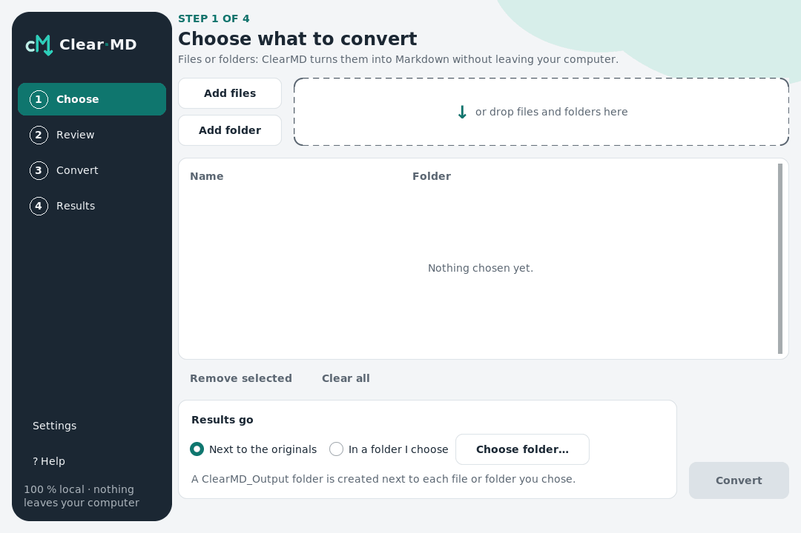
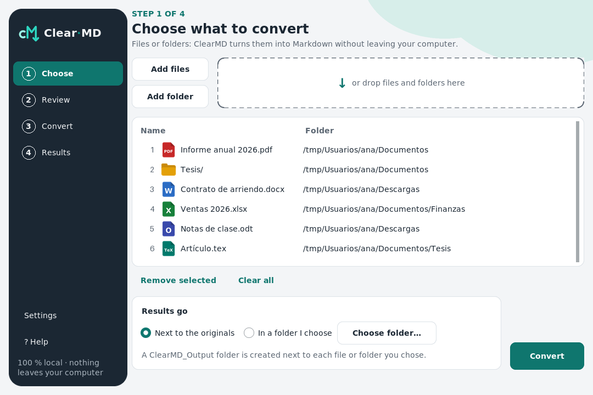
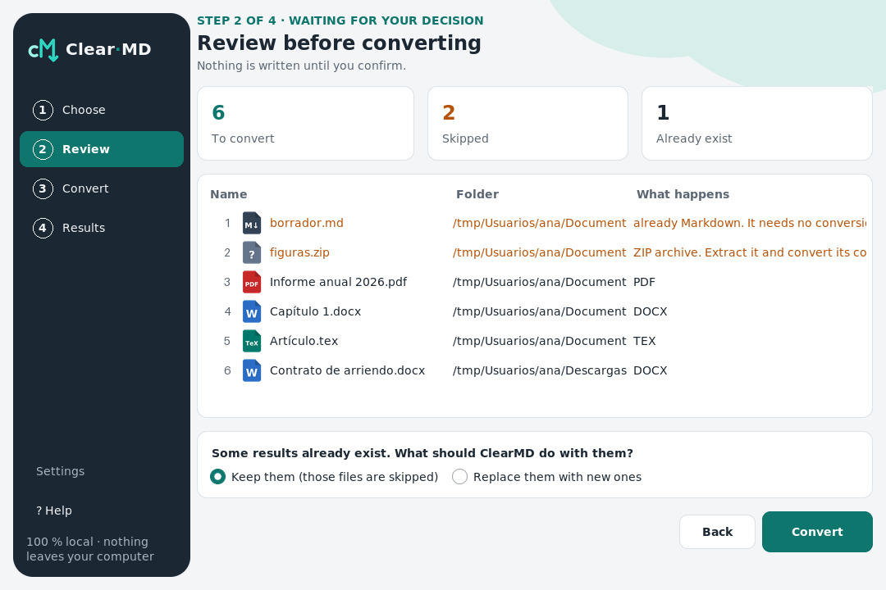
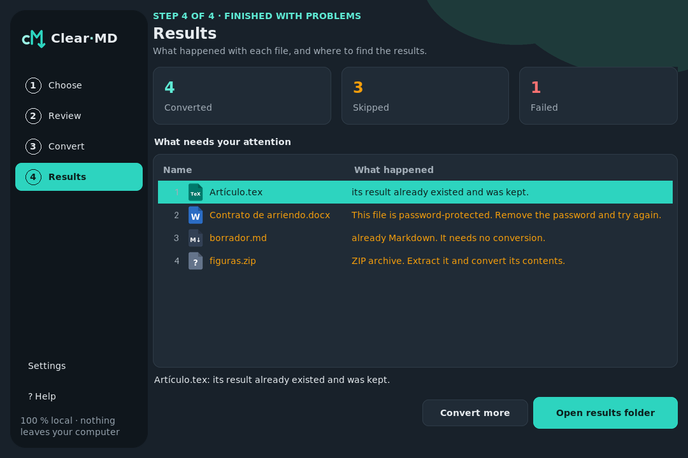

<div align="center">


# Clear·MD

**Turn your documents into Markdown — 100% local: ClearMD never uses the internet.**

_PDF, Word, OpenDocument, PowerPoint, Excel, HTML, CSV, EPUB, notebooks and LaTeX (equations kept) → clean Markdown, a whole
folder at once,
built first for people who never open a terminal._


[Leer en español](./README.es.md)

</div>

> 👋 **Want to see my other projects?** → **[github.com/ClearNote97](https://github.com/ClearNote97)**

---

## 🧩 The problem

> **Useful content is trapped in heavy formats, and the tools to free it are not made for everyone.**

Notes for Obsidian, documentation for GitHub, context for an LLM: all of them want Markdown, while the content
lives in PDFs, Word files and spreadsheets. The existing answers are command-line libraries, web services that
make you **upload your documents**, or single-format converters. None of them is made for someone who has never
opened a terminal — and private documents (contracts, medical records, unpublished theses) should never have to
leave the machine.

---

## 🧠 How I solved it

The value is in the method — a small product built like a serious one:

1. **Decisions first, recorded.** Every non-trivial choice is an ADR in [`docs/decisions/`](./docs/decisions/)
   (23 so far), with the rejected alternatives and the costs: why PySide6 and not PyQt6, why no pandoc, why no
   database, why a worker process.
2. **Spec before code.** Under **Spec-Driven Development**, [`spec/`](./spec/) says what *must* be true: feature
   001 has 44 acceptance criteria and 002 has 22, and a test fails if any criterion of any feature has no
   acceptance test.
3. **A core that knows nothing of the outside.** Hexagonal architecture laid out with the `backend/` and
   `frontend/` folders of my template: the use cases import only the standard library; markitdown and magika live
   behind ports and run **only in a worker process**.
4. **Untrusted files, handled as such.** Zip bombs are caught from the archive index before anything is
   decompressed; links are never followed; each file runs under a time limit and a memory limit (with a hard cap
   from the OS); a link planted in the output folder cannot redirect a write; Ctrl+C stops at once. A LaTeX
   thesis is followed only inside its folder and its macros expand within a budget (a macro bomb stops), and the
   Markdown never holds HTML, a remote image or a link the document did not write as LaTeX — checked in the
   test suite by a CommonMark parser and a seeded fuzz. An `.odt` is read with ClearMD's own XML reader (no
   `DOCTYPE`, limits on size and depth), with the same guarantee and a budget so that no small file can
   multiply into a huge Markdown. A web page in **article mode** (`--html article`) keeps only its article —
   no menus, cookie banners or footers — written by ClearMD with the same guarantee: its images are never
   fetched, and a page with no article is written whole by ClearMD too.
5. **Measured, not guessed.** Benchmarks ([001](./docs/benchmarks/001-conversion-limits.md),
   [002](./docs/benchmarks/002-tex-converter.md), [003](./docs/benchmarks/003-odt-converter.md),
   [004](./docs/benchmarks/004-html-article-mode.md)) set the limits and the speed of each format: PDF is the time bottleneck (~10 pages/s), xlsx the memory one, a 300-page
   LaTeX thesis takes ~3 s and a 300-page `.odt` report under a second. Files are converted from
   the cheapest to the most expensive, and the time left is estimated from the real speed of the batch.
6. **Reviewed by independent eyes.** A code review, a security audit and an adversarial verification of the
   fixes — which found real gaps in the first round of fixes, closed before shipping. For the LaTeX and the
   OpenDocument converters it took three rounds each, for the article mode two: every one is in the history,
   with the test that reproduces every finding.

> 🤖 I built this with an AI agent (**Claude Code**): I direct — I define the problem, decide the design and
> review every step; the agent executes and leaves everything traced.

---

## 👀 A look

**The desktop app** — a real batch, from choosing a folder to the results (no internet involved):



| Choose | Review | Results |
|---|---|---|
|  |  |  |

Light and dark, English and Spanish: every screen is in [`docs/screenshots/005/`](./docs/screenshots/005/).

**The command line** — a mixed folder, with a password-protected PDF, a document without extension, two files that would get the same
name, and a zip bomb disguised as a Word file:

```text
$ clearmd Thesis/
– Skipped: invoice.docx — grows 338 times when decompressed; limit 100 (possible zip bomb). If you trust
  it, save a new copy from its program.
[1/5] Report.docx
[2/5] scan · less than a minute left
[3/5] report.pdf · less than a minute left
[4/5] data.xlsx · less than a minute left
[5/5] contract.pdf · less than a minute left
✗ Failed: contract.pdf — This file is password-protected. Remove the password and try again.
4 converted · 1 skipped · 1 failed
Results: ClearMD_Output
```

And the `Resumen_ClearMD.md` it leaves next to the results:

| Source | Output | Format | Time |
|---|---|---|---|
| `Thesis/Report.docx` | `OutputMD/Thesis/Report (docx).md` | DOCX | <1 s |
| `Thesis/scan` | `OutputMD/Thesis/scan.md` | DOCX, detected by content | <1 s |
| `Thesis/report.pdf` | `OutputMD/Thesis/report (pdf).md` | PDF | <1 s |
| `Thesis/chapters/data.xlsx` | `OutputMD/Thesis/chapters/data.md` | XLSX | <1 s |

_Plus the failed and skipped files with a plain-words reason, and the history of earlier batches._

---

## 🚧 Status

| Feature | | |
|---|---|---|
| **001** Batch conversion — backend + CLI | ✅ done | 512 tests · reviewed |
| **002** `.tex` converter (math preserved, no pandoc) | ✅ done | 807 tests in total · reviewed |
| **003** `.odt` converter (standard library only) | ✅ done | 1085 tests in total · reviewed |
| **004** HTML article mode | ✅ done | 1287 tests in total · reviewed |
| **005** First desktop app (ttkbootstrap) | ✅ done | 1622 tests in total · reviewed |
| **006** CI + Windows/Linux executables | ✅ done | CI on Linux and Windows · executables checked by a real batch |
| **007–010** Navigation, PDF quality, a human summary, a light executable | ⏳ | |
| **011–012** PySide6 and flet apps | ⏳ | |

Full plan in the [roadmap](./spec/roadmap.md). ClearMD has a **command line** and its first **desktop app**
(`clearmd-ttk`), both also as Windows and Linux executables built and checked by CI.

---

## ▶️ How to run

**Download the app** (nothing to install): from the [latest release](https://github.com/ClearNote97/ClearMD/releases/latest),
`ClearMD-…-windows.exe` for Windows or `ClearMD-…-linux.tar.gz` for Linux, then open it with a double click.
Windows may warn that the app is not recognized, because it is not code-signed yet: *More info → Run anyway*.
The first start takes a few seconds while the app unpacks itself.

**From the repository**, for the command line (the package is not on PyPI yet):

```bash
uv tool install git+https://github.com/ClearNote97/ClearMD   # recommended: same tool as the dev stack
# or: pip install git+https://github.com/ClearNote97/ClearMD  (Python 3.12–3.14)

clearmd-ttk                              # the desktop app
clearmd report.pdf notes.docx            # files
clearmd ~/Documents/project              # a whole folder, subfolders included
clearmd thesis/ --output-root ~/Desktop  # results in ~/Desktop/ClearMD_Output
clearmd project/ --dry-run               # see the plan, write nothing
clearmd report.pdf --lang es             # messages in Spanish
clearmd saved_page.html --html article   # only the page's article
```

| Option | What it does |
|---|---|
| `--overwrite` / `--skip` | What to do with outputs that already exist. Without either, ClearMD asks once. |
| `--recursive` / `--no-recursive` | Include subfolders or not (default: yes). |
| `--output-root DIR` | Create `ClearMD_Output` inside `DIR`. |
| `--dry-run` | Show what would happen; write nothing. |
| `--open` | Open the results folder when done. |
| `--html {full,article}` | Web pages: the whole page (default) or only its article. |
| `--lang {en,es}` | Language for this run. |
| `-q`, `--quiet` | Only the summary and errors. |

**Exit codes:** `0` all converted · `1` some file failed or was stopped · `2` usage error or no valid input ·
`3` outputs exist and nobody can answer · `130` cancelled. **Settings** (optional): `settings.toml` in your
user configuration folder (on Linux `~/.config/ClearMD/`) — `language = "es"`, `on_existing_output = "skip"`,
`recursive = false`, `html_strategy = "article"`…

> 🔒 ClearMD never uses the internet. If you save the results in a folder synced by OneDrive, Google Drive or
> Dropbox, that app may upload them — that is the sync app, not ClearMD.

---

## 📦 What it produces

```
ClearMD_Output/          next to what you chose (or in --output-root)
  Resumen_ClearMD.md     what was converted (old name → new name, format, time), stopped, failed or skipped,
                         and the history of earlier batches
  OutputMD/              the Markdown files, mirroring your folders
```

---

## 🗂️ Structure

```
.
├── src/clearmd/
│   ├── backend/
│   │   ├── api/         # the facade every interface calls + the composition root
│   │   ├── schemas/     # immutable data: plans, reports, limits, error codes (stdlib only)
│   │   ├── use_cases/   # scan → plan → order → execute → report, and the ports (stdlib only)
│   │   └── services/    # worker process, markitdown and magika adapters, summary, settings
│   ├── frontend/cli/    # the command-line interface (the GUIs arrive here, one folder each)
│   └── i18n/            # EN/ES message catalogs
├── spec/                # ★ Spec-Driven Development: constitution, roadmap, feature specs, UX contract
├── docs/                # architecture, 25 ADRs, benchmarks
├── tests/               # unit (mirror of src) · acceptance (one per criterion) · fixtures · benchmark
└── .devcontainer/       # reproducible environment (non-root, uv)
```

---

## 🛠️ Stack

**Python 3.12–3.14** · **[markitdown](https://github.com/microsoft/markitdown)** (conversion) ·
**[magika](https://github.com/google/magika)** (detection by content) ·
**[trafilatura](https://github.com/adbar/trafilatura)** (finding a page's article) ·
**[pylatexenc](https://github.com/phfaist/pylatexenc)** (reading LaTeX) · **psutil** (worker limits) ·
**platformdirs** · **[ttkbootstrap](https://github.com/israel-dryer/ttkbootstrap)** + **tkinterdnd2** + **Pillow**
(the desktop app) · **pytest · ruff · mypy --strict** · **uv** · **Dev Container + Docker**.

**Base template:** [ClearNote_Dev](https://github.com/ClearNote97/ClearNote_Dev) — my flagship template for
Python development under Spec-Driven Development. ClearMD was born from it and pruned: no database, no web
backend — a desktop tool ([ADR-0009](./docs/decisions/0009-template-pruning.md)).

**Development:** open the folder in VS Code → *Reopen in Container*; then `uv run pytest`,
`uv run ruff check .`, `uv run mypy`. Working with AI agents follows [`README_AGENTS.md`](./README_AGENTS.md).

---

## 🙏 Credits

- **Author:** MSc. Nicolás Enrique Valencia Santiago.
- **Work partner:** AI agent (Claude / Claude Code, within the [Helix](https://github.com/ftuga/helix_asisten)
  framework by [ftuga](https://github.com/ftuga)).
- **Built on these libraries, with thanks to their authors.** ClearMD's own work is what comes out: the
  Markdown it writes, its guarantee and its notes; these find and read the content.

  | Library | What it does in ClearMD | License |
  |---|---|---|
  | [markitdown](https://github.com/microsoft/markitdown) (Microsoft) | converts PDF, Word, PowerPoint, Excel, HTML, CSV, EPUB and notebooks | MIT |
  | [magika](https://github.com/google/magika) (Google) | detects the format of files without an extension | Apache-2.0 |
  | [trafilatura](https://github.com/adbar/trafilatura) (Adrien Barbaresi) | finds the article of a web page (article mode) | Apache-2.0 |
  | [pylatexenc](https://github.com/phfaist/pylatexenc) (Philippe Faist) | reads LaTeX for ClearMD's `.tex` converter | MIT |
  | [psutil](https://github.com/giampaolo/psutil) (Giampaolo Rodolà) | measures the worker's memory | BSD-3-Clause |
  | [platformdirs](https://github.com/tox-dev/platformdirs) | finds where the settings live on each system | MIT |
  | [ttkbootstrap](https://github.com/israel-dryer/ttkbootstrap) (Israel Dryer) | themes for the desktop app (tkinter) | MIT (parts Apache-2.0 or BSD-2-Clause) |
  | [tkinterdnd2](https://github.com/Eliav2/tkinterdnd2) (with tkdnd) | dropping files on the window | MIT |
  | [Pillow](https://github.com/python-pillow/Pillow) | draws the window's rounded shapes and ClearMD's icons | MIT-CMU |

  Each one brings its own dependencies, under their own licenses (all permissive); `uv.lock` lists them.

## ⚖️ License

[MIT](./LICENSE) © 2026 Nicolás Enrique Valencia Santiago.
