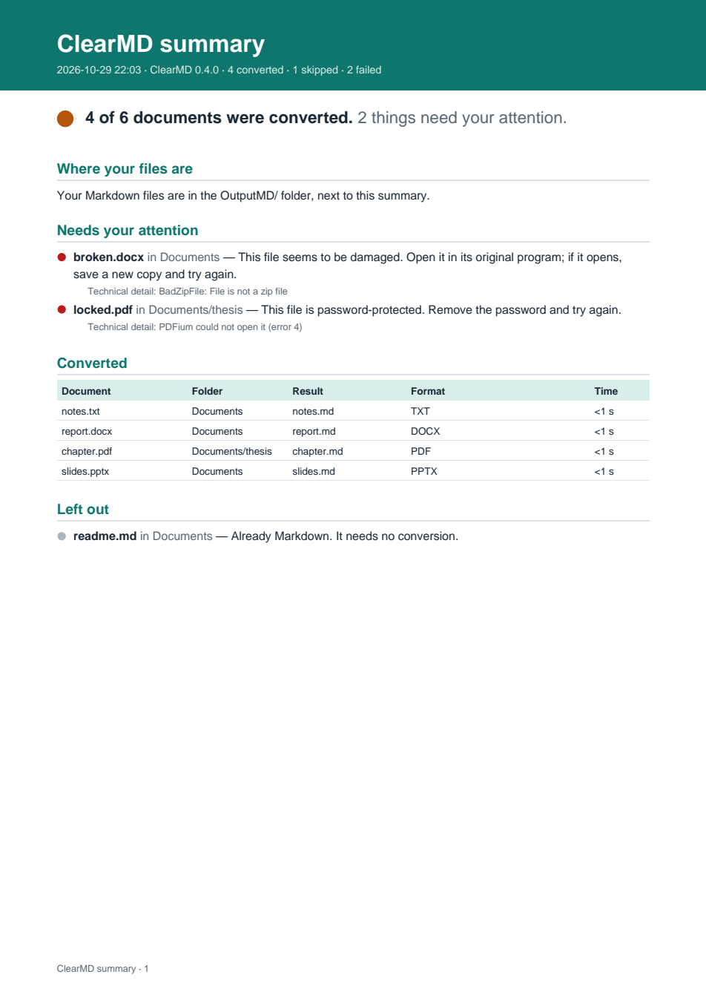

# docs/screenshots/009 — The summary in human language, and its PDF (feature 009)

Generated, never edited by hand (in the dev container):

```bash
uv run python tests/gui/summary_samples.py --out docs/screenshots/009   # a real batch of the test documents
uv run python tests/gui/screenshots.py --out docs/screenshots/009 --only 1-choose,6-settings
```

| File | What |
|---|---|
| [`summary-en.md`](./summary-en.md), [`summary-es.md`](./summary-es.md) | `Resumen_ClearMD.md` of a real batch, as written |
| [`summary-en.pdf`](./summary-en.pdf), [`summary-es.pdf`](./summary-es.pdf) | `Resumen_ClearMD.pdf` of the same batch |
| `summary-pdf-*.png` | The PDF's first page |
| `1-choose-*` | Step 1: the summary's format, under where the results go |
| `6-settings-*` | The same choice in Settings |


